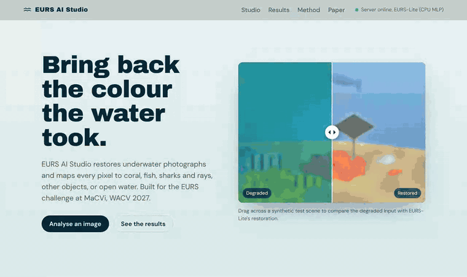
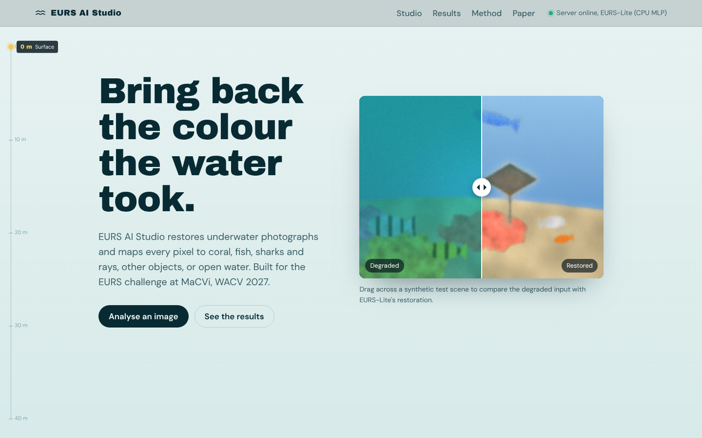
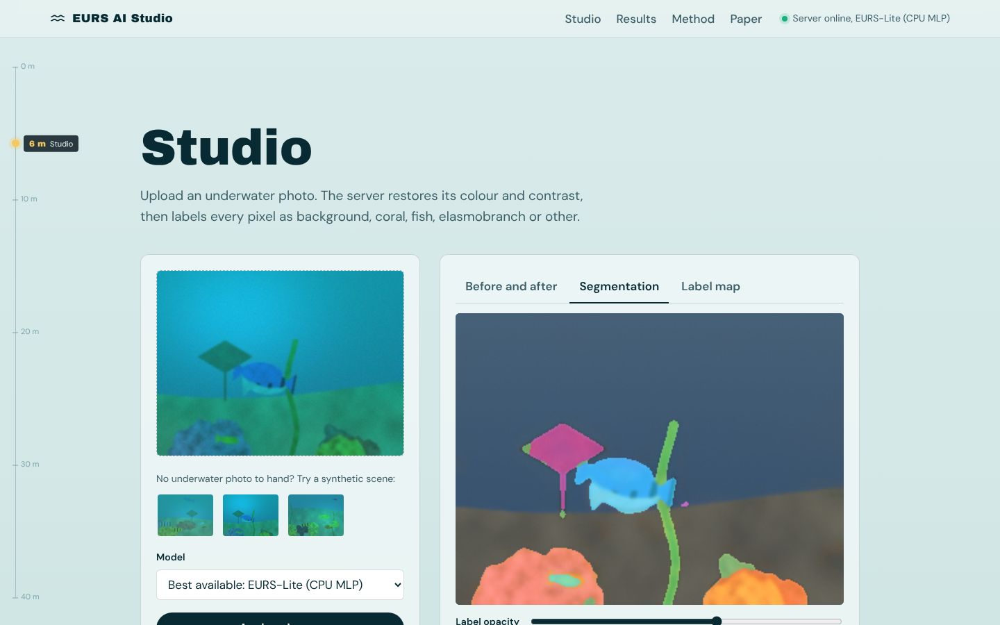
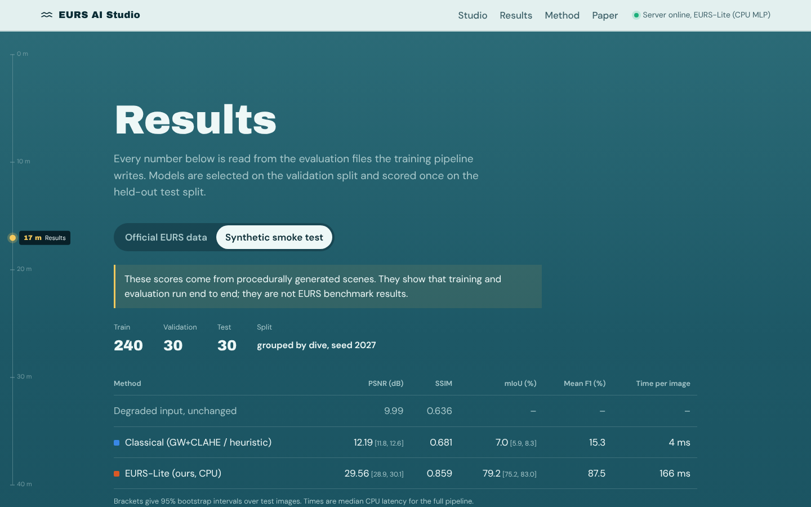
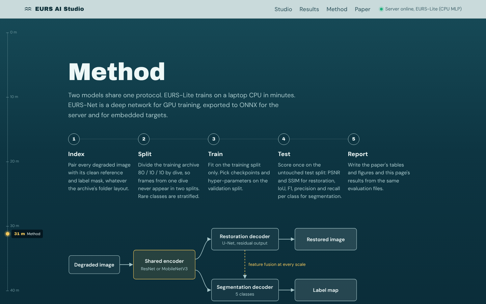
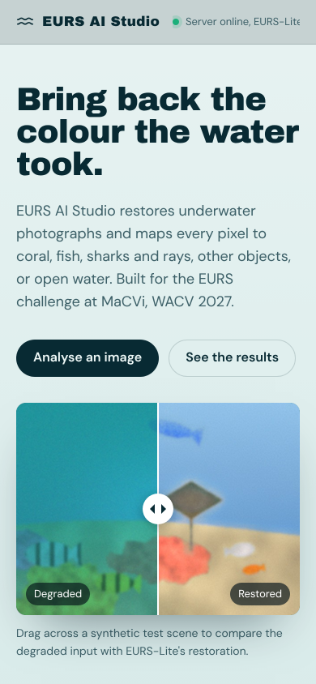
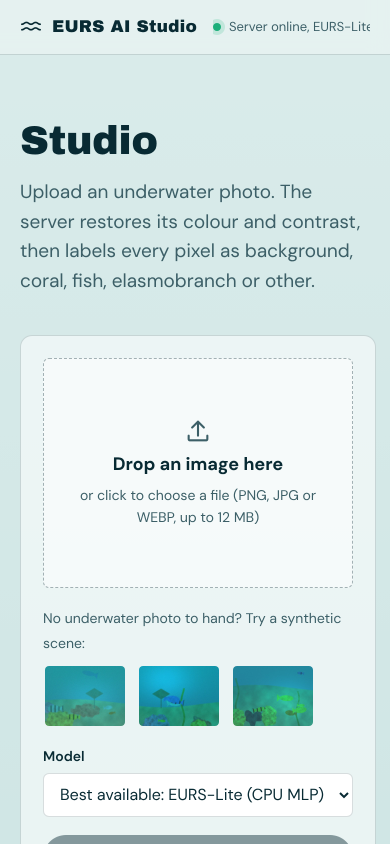
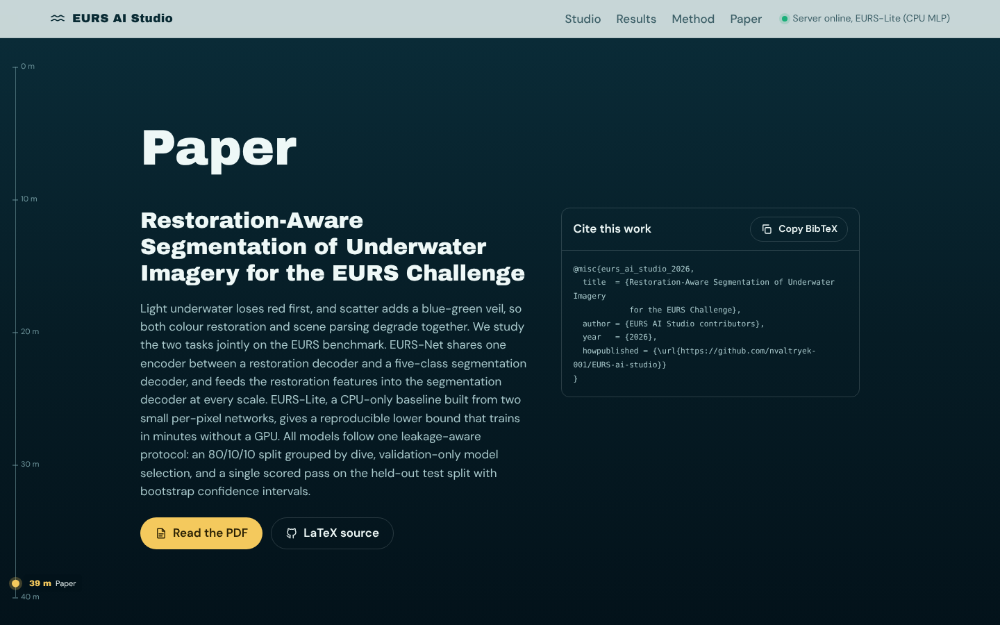
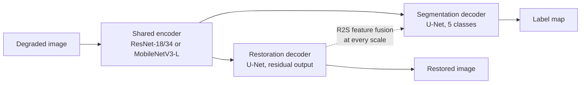
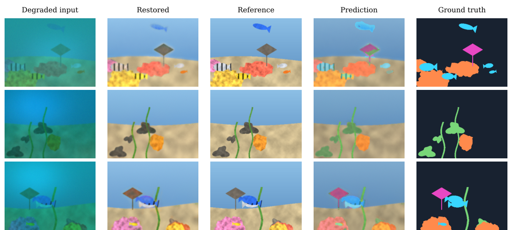

# EURS AI Studio

**Underwater image restoration and five-class marine segmentation for the [EURS challenge](https://www.macvi.org/workshop/macvi27/challenges/eurs) (MaCVi @ WACV 2027).**

The repository covers the full research loop: a reproducible train / validation / test protocol, two models (a CPU baseline and a deep multi-task network), evaluation with confidence intervals, an auto-generated paper draft, and a web studio that serves the trained models.

[](https://github.com/nvaltryek-001/EURS-ai-studio/actions/workflows/ci.yml)
&nbsp;**Live site:** https://eurs-ai-studio.vercel.app &nbsp;·&nbsp; **API:** https://eurs-ai-studio.onrender.com/docs &nbsp;·&nbsp; **Paper draft:** [`paper/main.pdf`](paper/main.pdf)

<p align="center">
  <a href="docs/demo/EURS-ai-studio-demo.mp4"></a>
  <br/><sub>Real recording of the frontend and the API running locally with an EURS-Lite model trained on the <b>synthetic</b> smoke-test set. <a href="docs/demo/EURS-ai-studio-demo.mp4">Watch the MP4</a>.</sub>
</p>

---

## Project status

| Component | Status |
|---|---|
| Dataset indexing + dive-grouped **train / val / test** split | ✅ Done, tested |
| **EURS-Lite** (CPU) training, validation-based model selection, test evaluation | ✅ Done, run end to end on synthetic data |
| **EURS-Net** (PyTorch, dual decoder + R2S fusion), ONNX export | ✅ Written; exercised by the CI job (1 epoch on synthetic data). Needs a GPU run on EURS |
| Metrics: PSNR, SSIM, UCIQE, per-class IoU / F1 / precision / recall, bootstrap 95% CIs | ✅ Done, unit-tested |
| API serving ONNX / Lite / classical models with auto-selection | ✅ Done |
| Redesigned web studio (compare slider, overlay, class composition, live results) | ✅ Done |
| Paper draft (LaTeX) with tables and figures generated from `results/` | ✅ Draft; **EURS numbers pending** |
| Training on the official EURS data | ⏳ **Your step**: see [Train on EURS](#train-on-the-official-eurs-data) |

> **No EURS benchmark numbers are claimed anywhere in this repository yet.** The official archives (22 GB + 8.6 GB) need to be downloaded and trained on a GPU. Every table in the paper and on the site fills in automatically from the evaluation files once you do.

## Screenshots

| Landing (before/after) | Studio (segmentation overlay) |
|---|---|
|  |  |
| **Results (from `results.json`)** | **Method** |
|  |  |

<p align="center">
&nbsp;&nbsp;
&nbsp;&nbsp;

</p>

---

## Task

Given a degraded underwater image, produce (1) a restored image and (2) a per-pixel label map:

| ID | Class | Colour |
|---|---|---|
| 0 | Background (water, seafloor) |  |
| 1 | Coral |  |
| 2 | Fish |  |
| 3 | Elasmobranch (sharks, rays) |  |
| 4 | Other |  |

## Models



| Model | What it is | Runs on | Weights |
|---|---|---|---|
| **Classical** | Gray-world + CLAHE + bilateral; colour-threshold "segmentation" | anything | none (lower bound) |
| **EURS-Lite** | Residual MLP on colour statistics + MLP pixel classifier on colour / context / texture features | CPU, NumPy only at inference | `eurs_lite.npz` (~24k params on synthetic) |
| **EURS-Net-Tiny** | Depthwise-separable encoder + two light decoders with R2S fusion; **0.119 M params, 3.38 GFLOPs** at 512² (fits EURS Track 2) | GPU to train; ONNX on Jetson/CPU | `eurs_net_tiny.onnx` |
| **EURS-Net** | ResNet-18 / MobileNetV3 encoder, two U-Net decoders, R2S fusion, L1 + SSIM + weighted CE + Dice loss (19.45 M / 70.6 GFLOPs: reference model) | GPU to train; ONNX on CPU | `eurs_net.onnx` + `.json` |

## Experimental protocol (train / validation / test)

1. **Index** the training archive: every degraded image is paired with its clean reference and mask by filename stem; the folder layout is auto-detected (or set with `--layout`).
2. **Split 80 / 10 / 10 by scene.** EURS provides several RSUIGM-degraded versions of each real scene. Every degraded image is paired with its scene's single clean reference and mask, and all versions of a scene land in the same split, so the test set never contains a scene seen in training. When scenes are unique, frames sharing a sequence prefix (e.g. `dive012_0003`) are grouped instead. Groups are stratified on their rarest class (usually elasmobranch). Seed 2027, written to `data/splits/<name>/manifest.csv`.
3. **Train** on `train` only. **Select** hyper-parameters / checkpoints on `val` only.
4. **Test once** on the untouched `test` split. Report PSNR, SSIM, UCIQE, per-class IoU / F1 / precision / recall, mIoU, and **95% bootstrap CIs over test images**, plus CPU latency.
5. The **dev archive** (`eurs_dev_degraded.zip`, no ground truth) is never used for training or selection: only for challenge submissions via `ml/predict.py`.

### Pipeline verification (synthetic data, *not* EURS results)

To prove the code runs end to end without the 30 GB download, `ml/eurs_ml/synthetic.py` renders procedural reef scenes with exact masks and degrades them with the underwater image-formation model *I = J·t + B·(1−t)*, *t = e<sup>−βz</sup>*. On its 30-image test split:

| Method | PSNR (dB) | SSIM | mIoU (%) | Mean F1 (%) | CPU ms/img |
|---|---|---|---|---|---|
| Degraded input (identity) | 9.99 | 0.636 | – | – | – |
| Classical | 12.19 [11.8, 12.6] | 0.681 | 7.0 [5.9, 8.3] | 15.3 | 4 |
| EURS-Lite | 29.56 [28.9, 30.1] | 0.859 | 79.2 [75.2, 83.0] | 87.5 | 175 |

<sub>Brackets: 95% bootstrap CIs. Per-class IoU for EURS-Lite: background 98.1, coral 91.5, fish 72.3, elasmobranch 53.4, other 80.9. Training took about 4 min on a 2-core CPU. Synthetic scenes are far easier than real imagery; these numbers only show the pipeline works.</sub>

<p align="center"></p>

---

## Repository layout

```
backend/
  app/main.py          FastAPI app (/api/health, /api/models, /api/process)
  app/service.py       framework-free request handling (unit-tested)
  eurs_core/           shared inference core: classical baseline, EURS-Lite, ONNX runner, registry
  models/              drop trained weights here (auto-discovered)
ml/
  prepare_dataset.py   index + leakage-aware split  -> data/splits/<name>/
  train_lite.py        EURS-Lite (CPU)              -> runs/<name>_lite/
  train_net.py         EURS-Net (PyTorch, GPU)      -> runs/<name>_net/
  export_onnx.py       checkpoint -> ONNX (+ numerical check vs PyTorch)
  evaluate.py          test-split metrics           -> results/<name>/<model>/metrics.json
  predict.py           batch inference (challenge dev set)
  make_report.py       paper tables + figures + frontend/public/results.json
  run_pipeline.sh      everything above in one command
  notebooks/train_eurs_colab.ipynb   free-GPU route straight from Google Drive
  eurs_ml/             discovery, IO, metrics, synthetic generator
  eurs_torch/          EURS-Net model, losses, dataset
frontend/              React + Vite web studio
paper/                 main.tex, refs.bib, generated/ tables, figures/, main.pdf
tests/                 pytest suite
```

## Quick start (local)

**Backend** (Python 3.10+):

```bash
cd backend
python -m venv .venv && source .venv/bin/activate      # Windows: .\.venv\Scripts\Activate.ps1
pip install -r requirements.txt
uvicorn app.main:app --reload --port 8000              # docs at http://localhost:8000/docs
```

**Frontend** (Node 20+):

```bash
cd frontend
npm install
echo "VITE_API_URL=http://localhost:8000" > .env.local
npm run dev                                             # http://localhost:5173
```

**Try the whole pipeline in ~5 minutes on CPU (synthetic data):**

```bash
pip install -r ml/requirements.txt
bash ml/run_pipeline.sh data/synthetic synthetic 300
cp runs/synthetic_lite/eurs_lite.npz backend/models/    # the API now serves EURS-Lite
```

## Train on the official EURS data

**Option A: Google Colab (recommended, free GPU).** Open [`ml/notebooks/train_eurs_colab.ipynb`](ml/notebooks/train_eurs_colab.ipynb) in Colab, add the [official folder](https://drive.google.com/drive/folders/10nWoxDEdWjKoIzYQp3--KSnWca3Vn4C5) to your Drive as a shortcut, and run all cells. It runs the split, both models, ablations and the report, then saves everything back to Drive.

**Option B: your own GPU machine.**

```bash
pip install -r ml/requirements-torch.txt            # install the CUDA build of torch first
unzip eurs_train.zip -d data/eurs_train
python ml/prepare_dataset.py --root data/eurs_train --out data/splits/eurs
#   check the printed counts: with_clean / with_mask must be > 0 and no unknown-mask-pixel warning.
#   If auto-detection is wrong: cp ml/configs/layout.example.json my_layout.json, edit, add --layout my_layout.json
NET_ARGS="--encoder resnet18 --epochs 60 --batch 8" bash ml/run_pipeline.sh data/eurs_train eurs
```

This writes `results/eurs/*/metrics.json`, regenerates `paper/generated/main_*.tex` and `paper/figures/main_*.pdf`, and updates `frontend/public/results.json`, so the site's **Results → Official EURS data** tab fills in.

**Ablations for the paper:**

```bash
python ml/train_net.py --manifest data/splits/eurs/manifest.csv --out runs/abl_nofusion --no-fusion
python ml/export_onnx.py --ckpt runs/abl_nofusion/best.pt --out runs/abl_nofusion/eurs_net_nofusion.onnx --name eurs_net_nofusion
python ml/evaluate.py --manifest data/splits/eurs/manifest.csv --model runs/abl_nofusion/eurs_net_nofusion.onnx --out results/eurs_ablation/no_fusion
# repeat with --encoder mobilenet_v3_large, --w-rest 0, --w-seg 0, then:
python ml/make_report.py --tag main --results results/eurs --split-report data/splits/eurs/split_report.json \
  --ablation results/eurs_ablation --train-log runs/eurs_lite/train_log.json --train-log runs/eurs_net/train_log.json
```

**Challenge submission (dev set):** `python ml/predict.py --model runs/eurs_net/eurs_net.onnx --input data/eurs_dev --out submissions/dev`. Check the challenge page for the required file format.

## Paper

**"See the Reef, Then Label It: A 0.12M-Parameter Network for Joint Underwater Restoration and Segmentation"**: [`paper/main.pdf`](paper/main.pdf) (LaTeX in `paper/`).

| | |
|---|---|
| **Target venue** | Workshop on Maritime Computer Vision (MaCVi), next edition (CVF workshop proceedings). MaCVi @ WACV 2027 closed its paper call on 16 Oct 2026. |
| **Track / topic** | Underwater image restoration, enhancement and colour correction, with an efficient real-time vision angle aimed at EURS **Track 2 (embedded, Jetson AGX Orin)** |
| **Format** | WACV/CVF style, ≤ 8 pages excluding references, anonymous. Port the body into the official author kit before submitting. |
| **Core claim** | EURS-Net-Tiny does joint restoration + 5-class segmentation with **0.119 M params and 3.38 GFLOPs** at 512×512, measured in CI (limit: 1.0 M / 12 GFLOPs). R2S fusion costs about 9 k params. |
| **Protocol** | Scene-grouped 80/10/10 split (EURS has many RSUIGM degradations per scene), validation-only selection, bootstrap CIs, open approximation of the official composite score |
| **Citations** | 31 references, including the required RSUIGM dataset paper (Desai et al., ACM TOMM 2024) and the MaCVi 2025/2026 challenge reports |

All result tables are `\input` from `paper/generated/` and figures from `paper/figures/`, both written by `ml/make_report.py`, so the paper's numbers always match the evaluation files. Red **`\todo{}`** boxes mark the only things left to fill: EURS result numbers and their interpretation, the GPU and Jetson timings, and the paper ID. Set `\draftfalse` to make LaTeX fail on any TODO left behind.

```bash
cd paper && pdflatex main && bibtex main && pdflatex main && pdflatex main
```

**Embedded-track model:** train it with `python ml/train_net.py ... --encoder tiny` and check the budget with `python ml/check_budget.py --encoder tiny --size 512`. Exported ONNX graphs use the Track 2 tensor names (`image` → `restored_image`, `seg_logits`).

## API

| Method | Path | Description |
|---|---|---|
| GET | `/api/health` | status, default model, whether a trained model is loaded |
| GET | `/api/models` | available models and their metadata |
| POST | `/api/process?model=auto&alpha=0.5` | multipart `file`; returns restored / colour mask / index mask / overlay PNGs (base64), class pixel counts and percentages, latency |

`model=auto` picks EURS-Net (ONNX) > EURS-Lite > classical, based on what is in `backend/models/`.

## Deployment

- **Frontend (Vercel):** root `frontend/`, build `npm run build`, output `dist/`, env `VITE_API_URL=https://eurs-ai-studio.onrender.com`.
- **Backend (Render, Docker):** `backend/render.yaml`. Set `CORS_ORIGINS=https://eurs-ai-studio.vercel.app`. To serve a trained model, add `eurs_net.onnx` + `eurs_net.json` (or `eurs_lite.npz`) to `backend/models/` with `git add -f`; they are git-ignored by default. Free instances sleep when idle, so the first request can take ~30 s.

## Tests and CI

`python -m pytest -q` covers metrics (hand-checked IoU cases), deterministic and leakage-free splitting, mask decoding, Lite save/load, the ONNX runtime contract and the API service. GitHub Actions additionally runs a CPU smoke test of EURS-Lite, a one-epoch EURS-Net train + ONNX export + evaluation, and the Vite production build.

## Limitations

- EURS results are pending a GPU run; the paper's results section is a structured draft until then.
- The dive-grouping heuristic relies on filename prefixes; confirm it matches the EURS naming.
- PSNR/SSIM assume the clean references are trustworthy; UCIQE is reported as a no-reference complement.
- EURS-Lite classifies pixels independently (plus smoothing) and struggles with thin and small objects.

## Citation

```bibtex
@misc{eurs_ai_studio_2026,
  title  = {See the Reef, Then Label It: A 0.12M-Parameter Network for Joint Underwater Restoration and Segmentation},
  author = {EURS AI Studio contributors},
  year   = {2026},
  howpublished = {\url{https://github.com/nvaltryek-001/EURS-ai-studio}}
}
```

## References

- MaCVi @ WACV 2027, EURS challenge: https://www.macvi.org/workshop/macvi27/challenges/eurs
- Official EURS dataset: https://drive.google.com/drive/folders/10nWoxDEdWjKoIzYQp3--KSnWca3Vn4C5
- Full bibliography: [`paper/refs.bib`](paper/refs.bib)

Fonts: Archivo Black and DM Sans, SIL Open Font License (`frontend/public/fonts/`).
